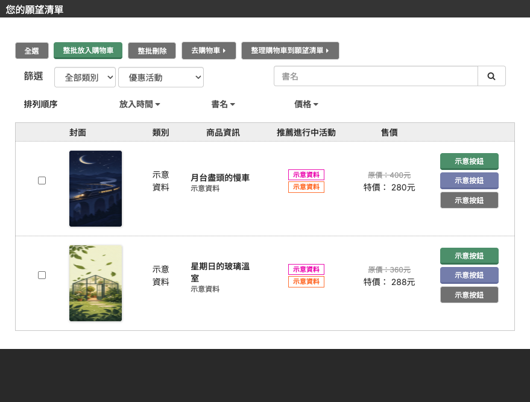
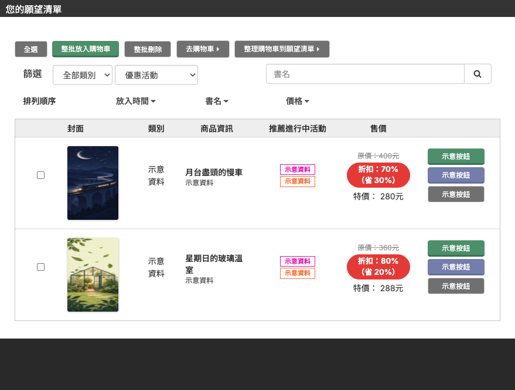

# BOOK☆WALKER 台灣願望清單價格比例 Userscript

在 BOOK☆WALKER 台灣願望清單的價格旁，補上「售價占原價比例」與「省下百分比」。

## 效果

| Before                                                                      | After                                                                        |
| --------------------------------------------------------------------------- | ---------------------------------------------------------------------------- |
|  |  |

> 截圖取自真實頁面版型，但已將書名、作者、出版社、價格與書封替換為虛構資料，未包含真實商品或個人資料。

## 功能

- 同時顯示售價占原價比例及省下百分比。
- 支援願望清單動態載入的新項目。
- 不傳送資料，也不需要額外權限。

## 安裝

1. 安裝 Tampermonkey、Violentmonkey 或其他相容的 userscript 管理器。
2. 開啟 [`bookwalker-wishlist-price-percentage.user.js`](https://raw.githubusercontent.com/VdustR/monkey-script-bookwalker-tw-wishlist-price-percentage/main/dist/bookwalker-wishlist-price-percentage.user.js)。
3. 在 userscript 管理器中確認安裝。
4. 開啟 BOOK☆WALKER 台灣的願望清單頁面。

## 開發

Requirements: Node.js `^22.18.0 || ^24.11.0 || >=26.0.0` and pnpm 11.

```bash
pnpm install
pnpm check
pnpm test
pnpm build
```

- `pnpm check`：以 Vite+ 執行 Oxfmt、Oxlint 與 TypeScript 7 typecheck。
- `pnpm test`：執行價格解析、比例計算與 DOM 行為測試。
- `pnpm build`：透過 Vite+／tsdown／Rolldown 產生單一 IIFE userscript。

## 專案結構

- `src/`：TypeScript 原始碼。
- `tests/`：Vitest 測試。
- `dist/`：可直接安裝的 `.user.js` 成品。
- `demo/`：只含假資料的離線手動檢查頁面。

## 授權

本專案以 [MIT License](LICENSE) 開源。

BOOK☆WALKER 是其權利人的商標。本專案為非官方工具，與 BOOK☆WALKER 無關。
